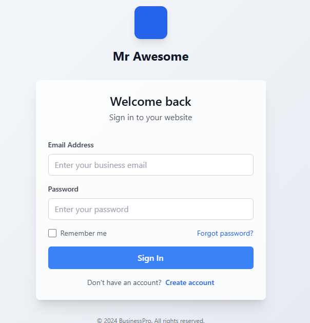

# BusinessPro Login UI Demo

A responsive React and TypeScript sign-in interface demonstrating validation, password visibility, loading, and feedback.

  



This retained repository screenshot shows the original design. The runnable React app now uses accessible native controls and explicitly labels simulated behavior.

## What this project demonstrates

- Controlled email/password fields with required-field, format, and length validation.
- Accessible field errors, focus on the first invalid input, and password visibility controls.
- A simulated asynchronous sign-in with duplicate-submit protection and loading feedback.
- Responsive layouts, reduced-motion support, and a keyboard-accessible demo-fill button.

**This is frontend UI only.** No backend authenticates users, no session or cookie is created, no password is stored, and no dashboard, sign-up, or password recovery is implemented. The sample brand and credentials are fictional. Use sample values instead of a real password.

## Run locally

Node.js 22.19 or later and npm:

```sh
git clone https://github.com/shazeel-ahmed31/LoginPage.git
cd LoginPage
npm ci
npm run dev
```

Open http://localhost:3000. Choose **Fill demo credentials**, optionally toggle visibility, then **Try demo sign-in**.

```text
Email: demo@business.com
Password: password123
```

The email is trimmed and compared without case sensitivity; the password comparison is exact. An 800-millisecond delay demonstrates the loading state; there is no network request. Success displays a message without redirecting.

## Structure and implementation

| File | Purpose |
| --- | --- |
| `app/page.tsx`, `app/layout.tsx` | Next.js entry point and metadata |
| `app/globals.css` | Responsive CSS, focus states, motion preferences |
| `components/business-login.tsx` | Controlled form and accessible interaction states |
| `lib/login.ts` | Validation and clearly named demo simulation |
| `tests/login.test.mjs` | Input and async simulation regression checks |
| `legacy/login.html` | Preserved standalone original page |
| `public/login.png` | Original screenshot |

The main app uses native form elements, plain CSS, and Lucide icons. Missing generated UI imports and unused template dependencies were removed. The previous middleware checked only the existence of an unverified cookie and redirected to nonexistent routes; it has been removed because this app does not implement authentication. It must not be reused as a security boundary.

The legacy page is a separate HTML demonstration using external CDN libraries. Its password-icon toggle and fake dashboard redirect were corrected, but it is not the primary application and is not served by Next.js.

## Checks

```sh
npm run typecheck
npm test
npm run build
npm start
```

Three automated test groups cover required fields, email normalization and invalid formats, password boundaries, exact demo matching, asynchronous loading completion, failed credentials, and early rejection before delay. Browser checks cover the interaction controls separately. Node's TypeScript stripping runs tests without a separate test-framework dependency.

During hydration the submit/demo-fill buttons remain disabled, and the fields have no submission names, preventing native form submission from putting sample inputs in a URL if JavaScript is unavailable.

Dependency installation, TypeScript checks, and all three test groups passed locally. Browser validation, password visibility, loading, demo success, and failure feedback were checked. `npm audit` reported zero vulnerabilities for the installed lockfile. A local production build was attempted but blocked by Windows `spawn EPERM`.

CI installs the npm lockfile, checks types, runs tests, and builds. Build errors are not suppressed. Local Windows production builds may be blocked by process restrictions; CI provides a Linux production-build check.

## Limitations and next steps

Validation is a UI exercise, not a production password policy. There is no authentication service, session persistence, server-side validation, rate limiting, or account storage. No live demo deployment is currently verified. A real authentication version would require an explicitly configured service and secure session implementation, plus integration tests.

## Author and license

[Shazeel Ahmed](https://github.com/shazeel-ahmed31). No license file is included.
